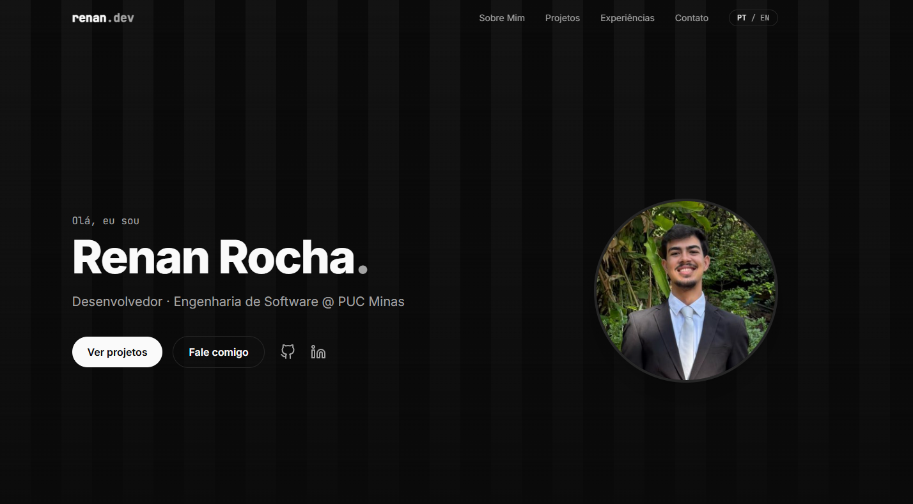
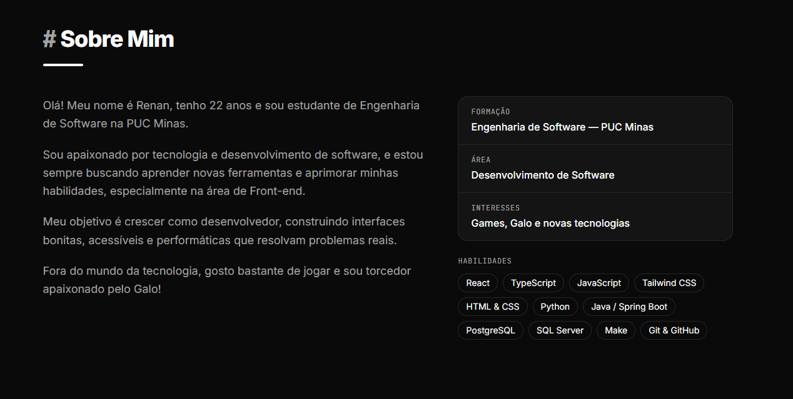
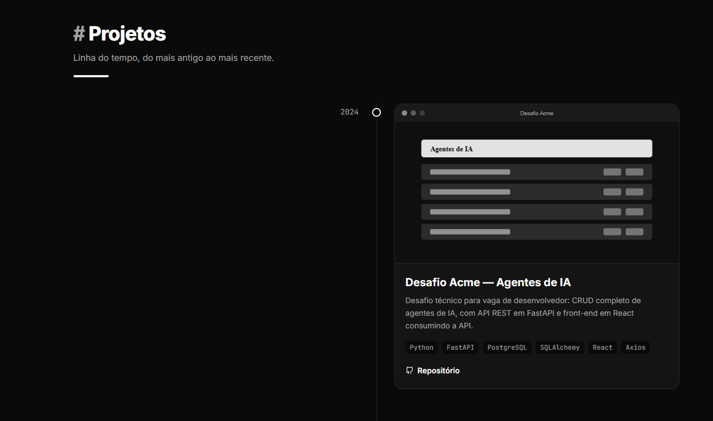
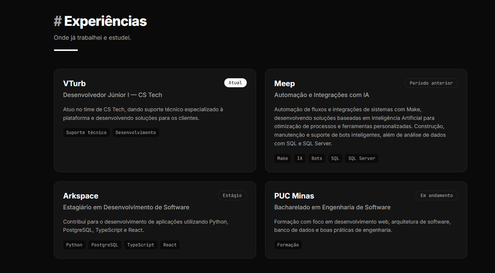
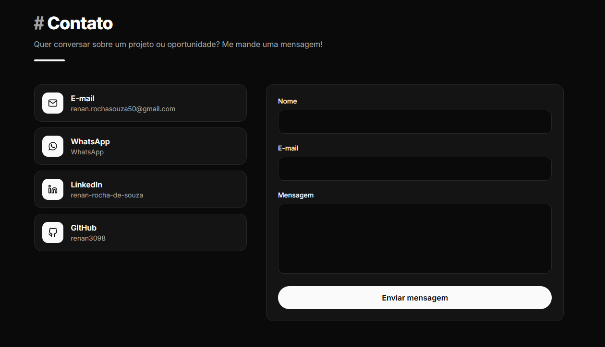

---

#  Portfólio — Renan Rocha 

> [!NOTE]
> Website de portfólio pessoal, **bilíngue (PT/EN) e responsivo**, que apresenta minha trajetória, projetos, experiências e formas de contato — com **formulário que envia e-mail direto do front-end**.

<table>
  <tr>
    <td width="800px">
      <div align="justify">
        Este repositório contém o <b>portfólio profissional</b> de <b>Renan Rocha de Souza</b>, estudante de <i>Engenharia de Software</i> na <b>PUC Minas</b>. O site reúne uma apresentação pessoal em português e inglês, uma <i>linha do tempo</i> com os projetos desenvolvidos (do mais antigo ao mais recente), as experiências profissionais e uma página de contato com ícones clicáveis e formulário de envio de mensagens por e-mail. A identidade visual em <b>preto e branco</b> é minimalista e inspirada nas listras do <b>Clube Atlético Mineiro</b>.
      </div>
    </td>
    <td>
      <div>
        
      </div>
    </td>
  </tr>
</table>

---

## 🚧 Status do Projeto

[](https://github.com/renan3098/portfolio/releases)        

---

## 📚 Índice
- [Links Úteis](#-links-úteis)
- [Sobre o Projeto](#-sobre-o-projeto)
- [Funcionalidades Principais](#-funcionalidades-principais)
- [Tecnologias Utilizadas](#-tecnologias-utilizadas)
- [Arquitetura](#-arquitetura)
- [Instalação e Execução](#-instalação-e-execução)
  - [Pré-requisitos](#pré-requisitos)
  - [Variáveis de Ambiente](#-variáveis-de-ambiente)
  - [Instalação de Dependências](#-instalação-de-dependências)
  - [Como Executar a Aplicação](#-como-executar-a-aplicação)
- [Deploy](#-deploy)
- [Estrutura de Pastas](#-estrutura-de-pastas)
- [Demonstração](#-demonstração)
- [Testes](#-testes)
- [Documentações utilizadas](#-documentações-utilizadas)
- [Autores](#-autores)
- [Licença](#-licença)

---

## 🔗 Links Úteis
* **Demo Online:** [Acesse o Portfólio](https://renan-portfolio.vercel.app)
  > **Descrição:** Aplicação em produção hospedada gratuitamente na **Vercel**.
* **Repositório:** [github.com/renan3098/portfolio](https://github.com/renan3098/portfolio)

---

## 📝 Sobre o Projeto

- **Por que ele existe:** projeto desenvolvido no laboratório da disciplina de *Desenvolvimento e Integração de Aplicações Web* (Engenharia de Software — PUC Minas), com o objetivo de construir um portfólio profissional real.
- **Qual problema ele resolve:** centraliza em um único lugar quem eu sou, o que já construí e como falar comigo — algo que um currículo em PDF ou um perfil no GitHub sozinhos não comunicam bem.
- **Contexto:** acadêmico e profissional.
- **Onde pode ser utilizado:** processos seletivos, networking, LinkedIn e apresentação para clientes e recrutadores (inclusive internacionais, graças à versão em inglês).

---

## ✨ Funcionalidades Principais

- **Tela inicial** com nome, foto e atalhos para projetos, contato, GitHub e LinkedIn.
- **Menu de navegação fixo** com rolagem suave e menu hambúrguer no mobile.
- **Internacionalização (PT/EN):** alternância de idioma em tempo real, com preferência salva no navegador.
- **Sobre Mim:** apresentação, formação, área de atuação, interesses e habilidades.
- **Linha do tempo de projetos:** do mais antigo ao mais recente, cada um com nome, descrição, tecnologias, link para o GitHub e imagem/GIF.
- **Experiências:** empresa/instituição, cargo, período e descrição.
- **Contato:** ícones clicáveis (E-mail, WhatsApp, LinkedIn, GitHub) e formulário com validação que envia e-mail via **EmailJS**.
- **Animações** de entrada e interação com **Framer Motion**.
- **Design responsivo** para celular, tablet e desktop.

---

## 🛠 Tecnologias Utilizadas

### Front-end

* **Biblioteca:** React 18
* **Linguagem:** JavaScript (ES6+) / JSX
* **Estilização:** Tailwind CSS 4
* **Animações:** Framer Motion
* **Formulários:** React Hook Form
* **Envio de e-mail:** EmailJS
* **Ícones:** React Icons
* **Gerenciamento de Estado:** Context API (idioma)
* **Build Tool:** Vite 6

### 🖥️ Back-end

* Não há back-end próprio: o envio de e-mails é feito diretamente do front-end pelo serviço **EmailJS**.

### ⚙️ Infraestrutura & DevOps

* **Hospedagem:** Vercel (plano gratuito)
* **Controle de versão:** Git + GitHub

### 📦 Dependências

| Pacote | Versão | Finalidade |
|---|---|---|
| `react` / `react-dom` | 18.3.1 | Construção da interface |
| `framer-motion` | 11.18.2 | Animações |
| `react-hook-form` | 7.x | Manipulação e validação do formulário |
| `@emailjs/browser` | 4.4.1 | Envio de e-mail pelo front-end |
| `react-icons` | 5.x | Ícones (GitHub, LinkedIn, WhatsApp, etc.) |
| `vite` *(dev)* | 6.4.4 | Servidor de desenvolvimento e build |
| `@vitejs/plugin-react` *(dev)* | 4.7.0 | Suporte a React/JSX no Vite |
| `tailwindcss` + `@tailwindcss/vite` *(dev)* | 4.3.3 | Estilização utilitária |

---

## 🏗 Arquitetura

Aplicação **SPA (Single Page Application)** estática, organizada em componentes React por seção. O conteúdo (projetos, experiências, textos) fica separado da apresentação em arquivos de dados, facilitando atualizações sem mexer nos componentes.

- **Componentização:** cada seção do menu é um componente (`About`, `Projects`, `Experience`, `Contact`), todos usando um wrapper comum (`Section`).
- **Dados desacoplados:** `src/data/*.js` contém perfil, projetos e experiências; `src/i18n/translations.js` contém os textos em PT e EN.
- **Context API:** `LanguageContext` fornece o idioma atual e a função de troca para toda a árvore.
- **Fluxo do formulário:** `React Hook Form` valida os campos → `EmailJS` envia a mensagem para o meu e-mail → feedback de sucesso/erro na tela.

```
Usuário ──▶ Formulário (React Hook Form) ──▶ EmailJS API ──▶ Gmail (Renan)
```

---

## 🔧 Instalação e Execução

### Pré-requisitos

* [Node.js](https://nodejs.org/) **v20 LTS ou superior** (inclui o npm)
* [Git](https://git-scm.com/)
* Uma conta gratuita no [EmailJS](https://www.emailjs.com/) (apenas para o formulário de contato)

### 🔑 Variáveis de Ambiente

Crie um arquivo **`.env`** na raiz do projeto (use o `.env.example` como base):

```
VITE_EMAILJS_SERVICE_ID=seu_service_id_aqui
VITE_EMAILJS_TEMPLATE_ID=seu_template_id_aqui
VITE_EMAILJS_PUBLIC_KEY=sua_public_key_aqui
```

| Variável | Onde encontrar no EmailJS |
|---|---|
| `VITE_EMAILJS_SERVICE_ID` | *Email Services* → seu serviço (ex.: Gmail) |
| `VITE_EMAILJS_TEMPLATE_ID` | *Email Templates* → template criado |
| `VITE_EMAILJS_PUBLIC_KEY` | *Account* → *General* → Public Key |

> **Obs:** O template do EmailJS deve usar as variáveis `{{name}}`, `{{email}}` e `{{message}}`. Em projetos **Vite**, as variáveis precisam começar com `VITE_` para ficarem disponíveis no código do cliente.

Na **Vercel**, cadastre as mesmas variáveis em *Settings → Environment Variables*.

### 📦 Instalação de Dependências

```bash
git clone https://github.com/renan3098/portfolio.git
cd portfolio
npm install
```

### ⚡ Como Executar a Aplicação

```bash
# Servidor de desenvolvimento (http://localhost:5173)
npm run dev

# Build de produção (gera a pasta /dist)
npm run build

# Pré-visualizar o build localmente
npm run preview
```

---

## 🚀 Deploy

O site é hospedado gratuitamente na **Vercel**:

1. Suba o projeto para o GitHub.
2. Em [vercel.com/new](https://vercel.com/new), importe o repositório `renan3098/portfolio`.
3. A Vercel detecta o **Vite** automaticamente (`Build Command: npm run build`, `Output Directory: dist`).
4. Adicione as variáveis `VITE_EMAILJS_*` em *Environment Variables*.
5. Clique em **Deploy**. A cada `git push` na branch `main`, um novo deploy é feito automaticamente.

Alternativa pela linha de comando:

```bash
npm install -g vercel
vercel --prod
```

---

## 📂 Estrutura de Pastas

```
.
├── .env.example              # 🧩 Exemplo das variáveis de ambiente (EmailJS).
├── .gitignore                # 🧹 Ignora node_modules, dist, .env, etc.
├── index.html                # 📄 HTML base (fontes, meta tags, título).
├── package.json              # 📦 Scripts e dependências.
├── vite.config.js            # ⚙️ Configuração do Vite + plugins React e Tailwind.
├── README.md                 # 📘 Documentação do projeto.
├── LICENSE                   # ⚖️ Licença MIT.
│
├── /docs                     # 📸 Capturas de tela usadas neste README.
│
├── /public                   # 🌍 Arquivos estáticos servidos na raiz.
│   ├── favicon.svg           # 🔖 Ícone do site.
│   ├── foto.jpg              # 👤 Foto exibida na tela inicial.
│   └── /projects             # 🖼️ Imagens/GIFs dos projetos da timeline.
│
└── /src
    ├── main.jsx              # 🚀 Ponto de entrada (monta o App + LanguageProvider).
    ├── App.jsx               # 🧱 Composição das seções da página.
    ├── index.css             # 🎨 Tailwind + tema (cores, fontes).
    ├── /components           # 🧩 Componentes de UI.
    │   ├── Navbar.jsx        #    Menu de navegação + troca de idioma.
    │   ├── Hero.jsx          #    Capa com nome, foto e chamadas.
    │   ├── Section.jsx       #    Wrapper com título animado.
    │   ├── About.jsx         #    Sobre Mim.
    │   ├── Projects.jsx      #    Linha do tempo de projetos.
    │   ├── Experience.jsx    #    Experiências.
    │   ├── Contact.jsx       #    Ícones de contato + formulário (EmailJS).
    │   └── Footer.jsx        #    Rodapé.
    ├── /data                 # 🗃️ Conteúdo editável do site.
    │   ├── profile.js        #    Nome, foto, links e habilidades.
    │   ├── projects.js       #    Projetos (PT/EN).
    │   └── experiences.js    #    Experiências (PT/EN).
    └── /i18n                 # 🌐 Internacionalização.
        ├── translations.js   #    Textos em português e inglês.
        └── LanguageContext.jsx #  Context API do idioma.
```

---

## 🎥 Demonstração

### 🌐 Aplicação Web

| Tela | Captura de Tela |
| :---: | :---: |
| **Início** | **Sobre Mim** |
|  |  |
| **Projetos (Timeline)** | **Experiências** |
|  |  |
| **Contato** | |
|  | |

---

## 🧪 Testes

Os testes foram realizados manualmente:

* ✅ Responsividade em larguras de 360px (mobile), 768px (tablet) e 1440px (desktop).
* ✅ Alternância de idioma PT ⇄ EN em todas as seções.
* ✅ Validação do formulário (campos obrigatórios, e-mail inválido, mensagem curta).
* ✅ Envio real de e-mail pelo EmailJS.
* ✅ Links de GitHub, LinkedIn, WhatsApp e e-mail.

---

## 🔗 Documentações utilizadas

* 📖 **Biblioteca (Front-end):** [Documentação Oficial do **React**](https://react.dev/)
* 📖 **Build Tool:** [Guia do **Vite**](https://vitejs.dev/guide/)
* 📖 **Estilização:** [Documentação do **Tailwind CSS**](https://tailwindcss.com/docs)
* 📖 **Animações:** [Documentação do **Framer Motion**](https://www.framer.com/motion/)
* 📖 **Formulários:** [Documentação do **React Hook Form**](https://react-hook-form.com/)
* 📖 **E-mail:** [Documentação do **EmailJS**](https://www.emailjs.com/docs/)
* 📖 **Deploy:** [Documentação da **Vercel**](https://vercel.com/docs)
* 📖 **Guia de Estilo:** [**Conventional Commits**](https://www.conventionalcommits.org/en/v1.0.0/)

---

## 👥 Autores

| 👤 Nome | :octocat: GitHub | 💼 LinkedIn | 📤 Gmail |
|---------|-----------------|-------------|-----------|
| Renan Rocha de Souza | <div align="center"><a href="https://github.com/renan3098"></a></div> | <div align="center"><a href="https://www.linkedin.com/in/renan-rocha-de-souza-2663a723b/"></a></div> | <div align="center"><a href="mailto:renan.rochasouza50@gmail.com"></a></div> |

---

## 📄 Licença

Este projeto está sob a licença **MIT**. Veja o arquivo [LICENSE](LICENSE) para mais detalhes.
